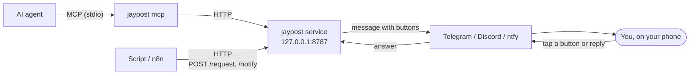

<div align="center">


# jaypost

**Let your AI agents and scripts ask you before they act.**

[](https://www.npmjs.com/package/jaypost)
[](https://github.com/bithyte/jaypost/actions/workflows/ci.yml)
[](LICENSE)
[](https://github.com/marketplace/actions/jaypost-approval)

[Website](https://bithyte.github.io/jaypost/) · [Docs](docs/README.md) · [npm](https://www.npmjs.com/package/jaypost)

</div>

They send a question, it pops up on your phone in Telegram, Discord or ntfy, you tap a button, and they get the answer back.

- Claude Code wants to run `git push --force`. You get Allow and Deny on your phone.
- A deploy script waits for your go-ahead.
- An n8n flow just tells you something happened.

Runs on your machine, talks only to you.

## Quick start

You need Node 24+ and a bot token, from [@BotFather](https://t.me/BotFather) on Telegram or the [Discord developer portal](docs/pairing.md#discord-setup). Or skip the bot and use [ntfy](docs/ntfy.md): just the app and a topic name.

```
npx jaypost init
```

It asks for your chat app and token, installs a small background service and prints a pairing code. Send `/start ABCD-EFGH` to your bot on Telegram (on Discord, add the bot with the invite link it prints, then DM it the bare code) and you're paired. ntfy has no pairing step. No Node? Use the [standalone binary](docs/install.md#standalone-binary).

Check it works:

```
jaypost ping
```

Using Claude Code? Install the plugin and permission prompts go to your phone:

```
/plugin marketplace add bithyte/claude-plugins
/plugin install jaypost@bithyte
```

## Ask from anywhere

| From              | How                                               | Docs                               |
| ----------------- | ------------------------------------------------- | ---------------------------------- |
| Claude Code       | plugin, or `jaypost hook` in your settings        | [Claude Code](docs/claude-code.md) |
| Any MCP agent     | `claude mcp add jaypost -- jaypost mcp`           | [Agents (MCP)](docs/mcp.md)        |
| Shell             | `jaypost request 'Deploy?' -o Approve -d Decline` | [Shell and Node](docs/scripts.md)  |
| Node              | `await new Client().request({ ... })`             | [Shell and Node](docs/scripts.md)  |
| curl, n8n, others | `POST http://127.0.0.1:8787/request`              | [HTTP API](docs/http-api.md)       |
| GitHub Actions    | `uses: bithyte/jaypost@v0`, no service needed     | [CI](docs/ci.md)                   |

## How it works



A small service on localhost holds each request open until you tap a button, reply, or the timeout fires, then returns your answer. It's single owner: one chat account, proven by the pairing code, and the API needs a token that `init` makes for you. See [Security](docs/security.md).

## Docs

- [Install](docs/install.md): targets (Podman, Docker, systemd, launchd), standalone binary, config, upgrading
- [Pairing](docs/pairing.md): pairing, changing owner, Discord setup
- [ntfy](docs/ntfy.md): phone notifications with no bot, on ntfy.sh or your own server
- [Claude Code](docs/claude-code.md): plugin, permission hook and replies to a finished turn
- [Agents (MCP)](docs/mcp.md): tools for any MCP client
- [Shell and Node](docs/scripts.md): `jaypost send` and the `Client`
- [HTTP API](docs/http-api.md): questions, background questions, notifications, attachments
- [Formatting](docs/formatting.md): the markdown subset messages support
- [CI](docs/ci.md): GitHub Action, direct mode, several approvers
- [Bot commands](docs/bot.md): `/pending`, `/cancel`, `/history`, quiet hours
- [Question log](docs/question-log.md): what was asked and how it ended
- [Commands](docs/commands.md): every CLI command
- [Security](docs/security.md)
- [Contributing](CONTRIBUTING.md)

## License

[Apache-2.0](LICENSE)
